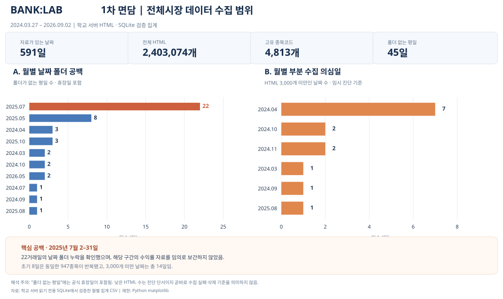

# BANK:LAB — 1차 면담 제출자료

## ① 읽어 들인 범위를 보이는 그림



그림은 **학교 서버 자료에서 검증된 월별 집계**로 만든 **Python `matplotlib` 막대그래프**다. 2025년 7월에 데이터 폴더가 없는 기간을 날짜별 시계열 선으로 연결하지 않았다.

- **수집 기록 범위:** 2024-03-27 ~ 2026-09-02
- **자료가 있는 날짜:** 591일
- **원본 HTML 합계:** 2,403,074개
- **고유 종목코드:** 4,813개 (일반주 외 상품 포함)
- **폴더 없는 평일:** 45일 (**공식 휴장일 포함**)
- **HTML 3,000개 미만인 날짜:** 14일 (부분 수집 점검용 임시 기준)
- **2025-07-02~2025-07-31:** 22거래일의 날짜 폴더 누락을 별도 확인함
- **초기 8개 날짜:** 동일한 947개 종목코드가 반복됨

**해석 주의:** 평일에 폴더가 없다는 것이 곧바로 거래일 누락이라는 뜻은 아니다. 반대로 휴장일에 HTML이 존재할 수도 있다. 원본 HTML과 기존 SQLite는 수정하지 않았다. 과거 API의 일부 종가 비교에서는 일치가 확인됐지만, 자료 전 항목의 일치나 22거래일 전면 복구가 완료됐다는 뜻은 아니다.

### 그림 재현

- [Python 코드](03_데이터범위_재현.py)
- [원자료의 월별 검증 집계](근거_월별공백현황.csv)

```bash
# matplotlib 패키지가 없다면 설치
python3 -m pip install matplotlib
python3 03_데이터범위_재현.py
```

## ② 큰 연구 질문 한 줄

> 같은 업종에 속한 기업들의 주가는 서로 어떤 관계를 보이며, 특정 기업의 주가 움직임이 다른 기업보다 먼저 나타나는 현상이 존재할까?

[질문 원문](02_큰질문_한줄.txt)

1차는 학교 서버 전체시장 데이터, 2차는 개인 GitHub에서 직접 수집한 은행업 11종목 데이터만 활용한다. 동조성·선행성 결과는 아직 이 1차 면담 제출 그림에서 추정하지 않았다.