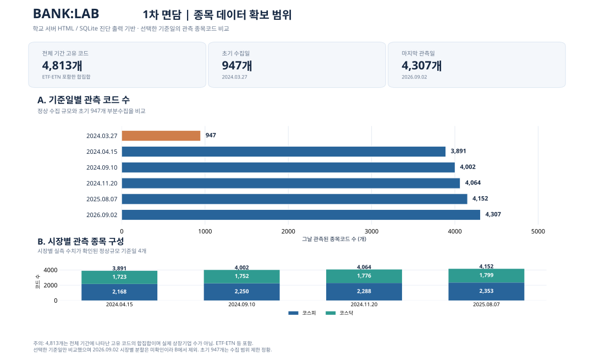

# BANK:LAB — 1차 면담 제출 자료

학교 서버 **전체시장 자료의 수집 범위(기간·종목코드 수·결측 분포)**와 연구 질문을 보여주는 제출 자료입니다. 자료는 원본 HTML을 보존하고 기존 SQLite를 읽기 전용으로 집계했습니다.

## ① 데이터 범위 및 공백 분포


- 기간: **2024-03-27 ~ 2026-09-02**
- 자료가 확인된 날짜: **591일**
- HTML 합계: **2,403,074개**
- 전체 기간 고유 종목코드: **4,813개** (ETF·ETN 등 포함 가능)
- 날짜 폴더가 없는 평일: **45일** (공식 휴장일 포함)
- HTML 수 3,000개 미만: **14일** (탐색적 진단 기준)
- 주요 공백: **2025-07-02 ~ 2025-07-31의 22거래일에 날짜 폴더 누락**

`01_데이터범위_그림.svg`는 `03_데이터범위_재현.py` 및 `근거_월별공백현황.csv`로 재현합니다.

## ② 종목구성 및 월별 관측 범위 (전체 591일)



**기준일 6개 비교 그래프를 전체 31개월 그래프로 교체했습니다.** 학교 서버 SQLite의 `obs` 테이블에서 날짜·시장별 `COUNT(DISTINCT code)`를 계산한 다음, 월별로 *관측된 날짜만의 평균*을 구했습니다.

- 상단 막대: **코스피 / 코스닥 월별 일평균 관측 종목코드 수**
- 하단 막대: **월별 자료가 존재하는 날짜 수**
- 2025년 7월: **1일만 관측**. 해당 월 종목 수(코스피 2,334개, 코스닥 1,796개)는 그 하루의 값임. 폴더 없는 22거래일은 **0개 종목으로 보간하지 않았음**
- 2024년 3월: 관측 1일, 코스피 947개·코스닥 0개로 초기 부분 수집 정황
- 2026년 9월: 9월 2일까지 **2일만 관측**, 따라서 월 전체의 완전한 수집을 뜻하지 않음
- **4,813개**는 전 기간 고유 코드의 합집합이며 일반 상장기업 수와 다름. ETF·ETN 등도 포함됨
- 매월 평균은 **부분 수집일의 영향을 받음**. 관측 종목 수 변화만으로 상장기업 수의 증가·감소를 주장하지 않음

검증 근거: `근거_월별종목수.csv` (2024-03 ~ 2026-09, **31개 월**, `days` 합계 **591일**).

### 그림 재현 (Python)

`matplotlib`가 설치되어 있다면 저장소 내에서 다음을 실행합니다.

```bash
python3 05_종목범위_재현.py
```

`05_종목범위_재현.py`는 `근거_월별종목수.csv`와 `06_전체기간_월별종목수.py`를 사용해 `04_종목범위_그림.png`, `04_종목범위_그림.svg`를 재생성합니다. 학교 서버에서는 `06_전체기간_월별종목수.py`를 직접 실행해 기존 SQLite에서 다시 집계할 수도 있습니다. **원본 HTML·SQLite는 수정하지 않습니다.** 서버에 한글 글꼴이 없으면 깨진 문자를 피하도록 영문 표기로 전환합니다.

기존 6개 기준일을 조사한 근거 `근거_기준일별종목수.csv`는 탐색 기록으로만 보존하며 **현재 최종 그림의 데이터는 아닙니다**.

## ③ 큰 연구 질문 한 줄

> 같은 업종에 속한 기업들의 주가는 서로 어떤 관계를 보이며, 특정 기업의 주가 움직임이 다른 기업보다 먼저 나타나는 현상이 존재할까?

[질문 원문](02_큰질문_한줄.txt)

첫 번째 연구는 **학교 서버 전체시장 자료**를 네이버 증권 업종 기준으로 분석하고, 두 번째 연구는 개인 GitHub의 **직접 수집한 은행주 11종목만**으로 동일 질문을 검토할 계획입니다. 이 폴더는 1차 면담의 **데이터 범위 검증 제출물**이며 업종 간 동조성·선행성 분석 결과를 의미하지 않습니다.